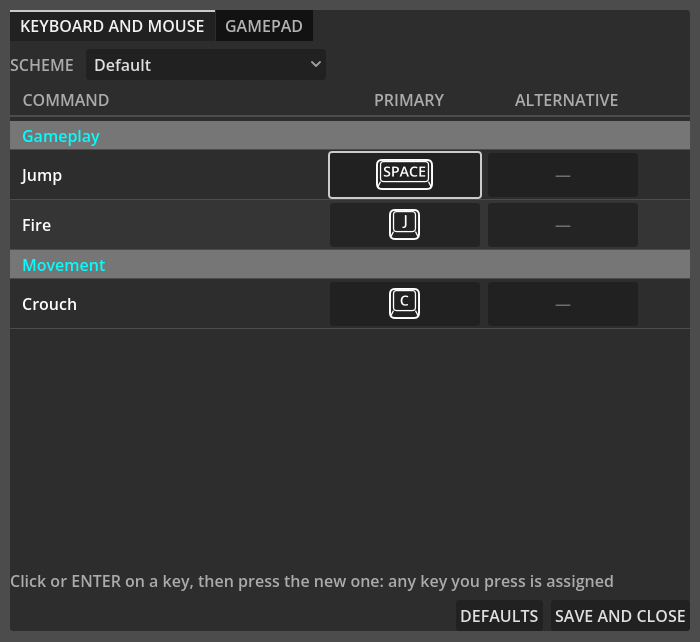

# Rebind Kit

Player-facing key and gamepad remapping for Godot 4.6, built on the project's `InputMap`.



- **Schemes per device**: a keyboard scheme and a gamepad scheme, each with its defaults (taken from the `InputMap` or
  from your data) and a custom scheme created the first time the player changes something. Every gamepad model
  remembers its scheme; a new model can reuse the custom scheme made for another one.
- **Two inputs per command**: primary and alternative. The alternative can be cleared, the primary never.
- **Conflicts that make sense**: commands are grouped by *scope* (the commands active at the same time). Picking an input
  already used in the same scope swaps the two, and the other command is flagged until the player confirms or rebinds
  it. Different scopes can share an input, and so can commands that list each other in `shares` (a click and a held
  drag on the same mouse button). Commands with a primary in the default scheme keep one; the others may be left empty.
- **Keyboard by position**: bindings use `physical_keycode`, so on an AZERTY keyboard WASD stays where it is, and the
  keycap shows the letter actually printed there.
- **Any key gets a drawing**: keycaps and gamepad buttons are drawn at runtime from any font's outlines, so you don't
  need an image per letter. Your own special drawings (Tab, Enter, sticks...) win over the generated ones.
- **A ready rebinding panel** (`RemapPanel`): tabs, scheme menu, a command table, listening for the new input, and the
  form for swapped commands. Plain Godot Controls: it follows your theme.

## Screenshots

| Swap to confirm | Gamepad |
|---|---|
|  |  |

This repository is also a Godot project: open it and run it to try the example scene.

## Install

From the editor: *AssetLib* tab, search **Rebind Kit**, download and install (only `addons/rebind_kit/` is installed).
By hand: copy `addons/rebind_kit/` into your project and enable **Rebind Kit** in *Project Settings > Plugins* (the plugin adds
nothing to the editor: you use its classes from code).

Try `addons/rebind_kit/example/remap_example.tscn`: three actions, the ready adapter and the panel.

## Quick start

```gdscript
# 1. Describe the commands the player can change. Groups are shown as sections of the table; a group's scope says
#    which commands are active together (without a scope, the group is its own scope; "global" clashes with all).
const CATALOG := {"groups": [
	{"id": "gameplay", "title": "Gameplay", "actions": [
		{"id": "jump", "title": "Jump"}, {"id": "fire", "title": "Fire"}]},
	{"id": "menus", "title": "Menus", "actions": [{"id": "ui_back", "title": "Back"}]},
]}

# 2. Create the remapper once, early (an autoload is a good place). It reads the defaults from the InputMap, so the
#    actions must exist by then. It loads the saved choices and applies them to the InputMap.
var remap := InputRemap.new(FileRemapAdapter.new(CATALOG))   # saves to user://rebind_kit.json
add_child(remap)

# 3. Show the panel when the player opens the controls screen.
var panel := RemapPanel.new(remap)
panel.closed.connect(panel.queue_free)
some_window.add_child(panel)
```

From then on `InputMap` holds the player's bindings: the rest of your game keeps using `is_action_pressed` as usual.

## Your own adapter

`InputRemap` asks everything about your game to a `RemapAdapter`. `FileRemapAdapter` covers the common case; extend
`RemapAdapter` (or `FileRemapAdapter`) to change any part:

| Method | What it gives |
|---|---|
| `catalog_data()` | the command catalog (format above) |
| `builtin_schemes(actions)` | the default schemes, in menu order (`ControlScheme.from_input_map`, `swap_keys`...) |
| `recognize_pad(name)` | the default scheme id for a gamepad name, or `&""` to ask the player |
| `load_state()` / `save_state(data)` | where the player's choices live (a file, your settings system...) |
| `text(id)` | every text of the panel (`RemapAdapter.TEXTS`) and the catalog titles: translate here |
| `key_texture(key)` / `key_name(key)` | how an input is drawn and named |

`pad_layouts()` (id -> title) adds a **layout** menu to the gamepad tab: what is printed on the buttons, chosen per
gamepad model and separate from the scheme. Read the choice with `InputRemap.pad_layout(guid)` (empty: automatic) to
name the buttons your way.

Signals on `InputRemap`: `changed` (bindings changed: refresh any on-screen key hints) and `unknown_pad(guid, name)`
(a gamepad nobody recognized: ask the player and answer with `choose_for_pad(guid, scheme_id, name)`).

## Panel

`RemapPanel.new(remap, colors)` takes an optional color dictionary (`text`, `dim`, `off`, `accent`, `warn`, `stripe`,
`line`). Set `confirmer` to show the "back to defaults" confirmation with your own dialog, and call `save_and_close()`
when the player presses your back button. Listening for a new input can't be cancelled: whatever the player presses
next is bound, so the gamepad tab only listens while a gamepad is connected.

`RemapPanel.new(remap, colors, family, table_height)` makes a panel for one family only, to use as a page of your own
window: no tabs and no SAVE AND CLOSE. Before moving away (another page, closing) ask `try_leave()`: it saves, or opens
the form of swapped commands and answers no.

## Keycaps

`KeyCapRenderer.new(font, special_dir)` draws `texture(id, label, shape, scale)`: shape `key` (keyboard keycap) or
`button` (gamepad dodecagon), white, to be tinted by whoever shows it. A file `special_dir/<slug(id)>.svg` replaces the
generated drawing. At scale 1 the texture also gets a resource path (`path_of(id)`), so rich text can show it with
`[img]`. Letters are always uppercase.

## Limits

- No modifier combinations (Ctrl+...).
- Two gamepads of the same model are the same gamepad (Godot identifies the model by GUID).
- `FileRemapAdapter` names gamepad buttons the Xbox way.
- The classes are global (`class_name`): `ControlScheme`, `FileRemapAdapter`, `InputKey`, `InputRemap`,
  `KeyCapRenderer`, `KeyCapture`, `KeyLabel`, `PadWatcher`, `RemapAdapter`, `RemapCatalog`, `RemapDraft`, `RemapPanel`,
  `SchemeApplier`, `SchemeLibrary`. If your project already has one of these names, rename yours or the plugin's.

## License

MIT, see `LICENSE`. Made for [Protocol Breach](https://lautz97.itch.io/protocol-breach) by Lautz97.
